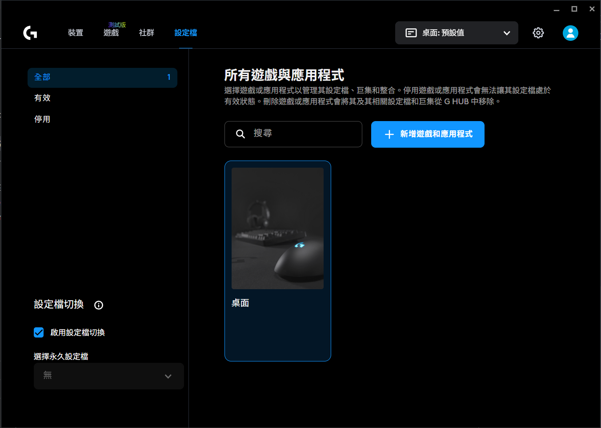
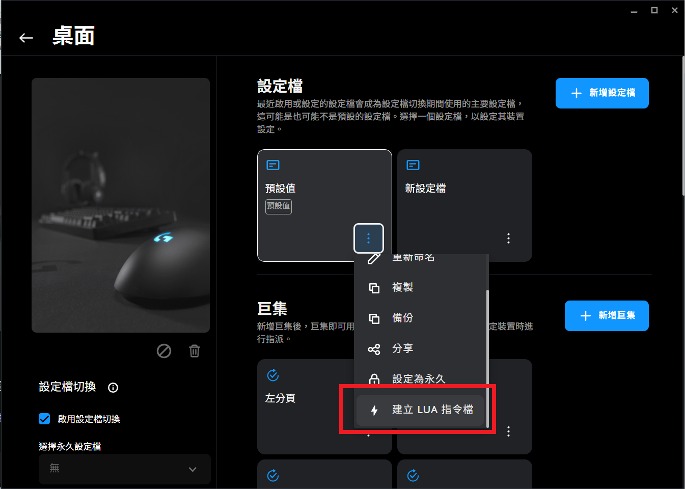
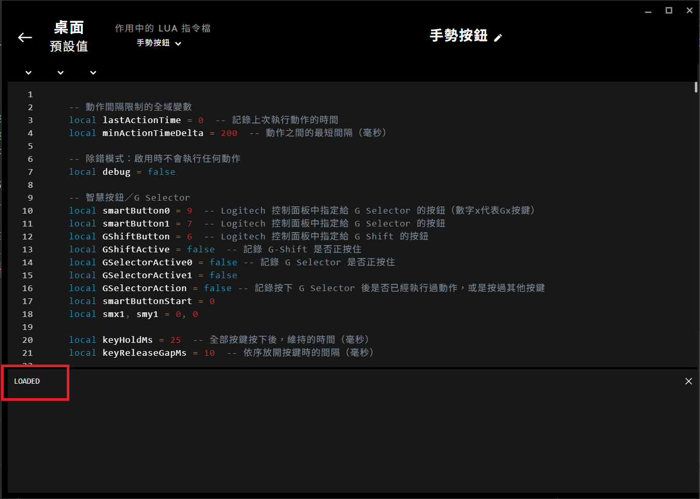

# G HUB Mouse Gesture Buttons

[繁體中文](README.md)

## Overview

This project uses a Lua script in [G HUB](https://www.logitechg.com/software/ghub) to provide gesture-button functionality similar to Logi Options+ on Logitech G-series devices. A selected G-key acts as a gesture button: hold it and move the mouse, then release it to perform an action based on the hold duration, movement distance, and direction.

The default setup targets Windows with a Logitech G502. Set the gesture-button numbers to match the button assignments in G HUB.

Due to limitations in the G HUB Lua API, the script cannot continuously track movement and smoothly switch applications while a gesture button is held, as a touchpad might. Instead, it determines the direction from the total movement between the press and release positions, then performs the corresponding action after the button is released.

Both gesture buttons share a single state, so the script is designed to process one gesture at a time.

- [Windows keyboard shortcuts](https://support.microsoft.com/accessibility/windows/keyboard-shortcuts-in-windows)
- [G-series Lua API documentation](https://douile.com/logitech-toggle-keys/APIDocs.pdf)

## Usage

In G HUB, go to Profiles (use the tab at the top) -> Desktop (or another application) -> Create a new Lua script -> Create a new Lua script



Copy the contents of `手勢按鈕G502.lua` and save them with `Ctrl+S`.


Once `LOADED` is displayed, the script is ready to use.

## Button Configuration

To assign different buttons, edit the variables at the beginning of the Lua file:

| Setting | Default | Description |
| --- | ---: | --- |
| `GSmartButton0` | `9` | First gesture button, G9 by default |
| `GSmartButton1` | `7` | Second gesture button, G7 by default |
| `GShiftButton` | `6` | G-Shift button, G6 by default |

## Default Actions

| Gesture | G9 | G7 |
| --- | --- | --- |
| Short press | Play/pause media | Open the application switcher (Alt+Ctrl+Tab) |
| Long press | Stop media | Send Enter to confirm the current selection |
| Left | Switch to the virtual desktop on the left (Win+Ctrl+Left) | Switch applications with Alt+Esc |
| Right | Switch to the virtual desktop on the right (Win+Ctrl+Right) | Switch applications in reverse with Alt+Shift+Esc |
| Up | Previous media track | Open Windows Task View (Win+Tab) |
| Down | Next media track | Show the desktop (Win+D) |

G9 media actions require the corresponding macros to be created in G HUB first. If you use different macro names, update the `PlayMacro("...")` string in the corresponding branch of `SmartButton0Action()` in the Lua file to match the G HUB macro name:

| Action | Category in `SmartButton0Action()` | Default macro name |
| --- | --- | --- |
| Play/pause | `SHORT_CLICK` | `媒體:播放/暫停` |
| Stop | `LONG_CLICK` | `媒體:停止` |
| Previous track | `UP` | `媒體:上一首` |
| Next track | `DOWN` | `媒體:下一首` |

## Gesture Detection

Hold G9 or G7, move the mouse, and then release the button. On release, the script determines the action from the hold duration and the movement between the press and release positions. Directional actions are not triggered in real time while the button is held.

- **Four-way gestures**: Four-way mode is used by default. Once movement is sufficient, the direction is determined by the primary movement axis: up, down, left, or right.
- **Eight-way gestures**: In `finishSmartButton0()` and `finishSmartButton1()`, change the `false` argument in calls to `classifySmartButtonAction(..., false)` to `true`. This additionally classifies the four diagonal directions. No actions are currently assigned to diagonals.
- **Short/long press**: If movement does not reach the gesture threshold, a hold shorter than `smartButtonDelta` (350 ms by default) is a short press; a hold equal to or longer than the threshold is a long press.
- **Movement distance limits**: Movement beyond `smartButtonDistanceMax` cancels the action. Once the minimum distance for a directional gesture is reached, the movement is classified by direction.

## Custom Actions

Edit the key or macro associated with a direction in `SmartButton0Action()` or `SmartButton1Action()`. For example, to make the G9 up gesture run another G HUB macro you have created:

```lua
elseif action == "UP" then
	PlayMacro("Your macro name")
	return true
```

To send a key combination, use `pressKeySequence(intervalMs, ...)`. The first argument is the delay in milliseconds between pressing each key. Keys are pressed in order and released in reverse order.

## Notes

- Gesture actions are classified and performed only after the button is released; movement is not tracked continuously while it is held.
- G9 and G7 share the start time, starting coordinates, and action-limit state. The current flow intentionally handles one gesture at a time and does not support using both gesture buttons simultaneously.
- Diagonal direction classification and action branches are not yet complete; do not expect diagonal gestures to perform an action.
- Button names and shortcut behavior may vary depending on G HUB, the Windows version, system language, and the active application.
