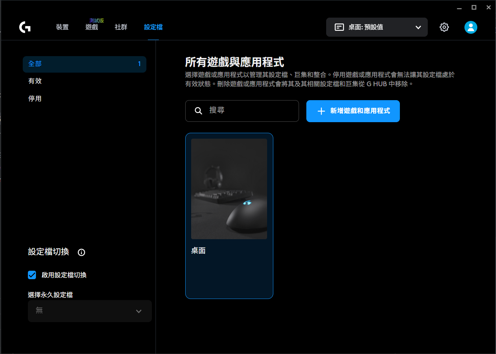
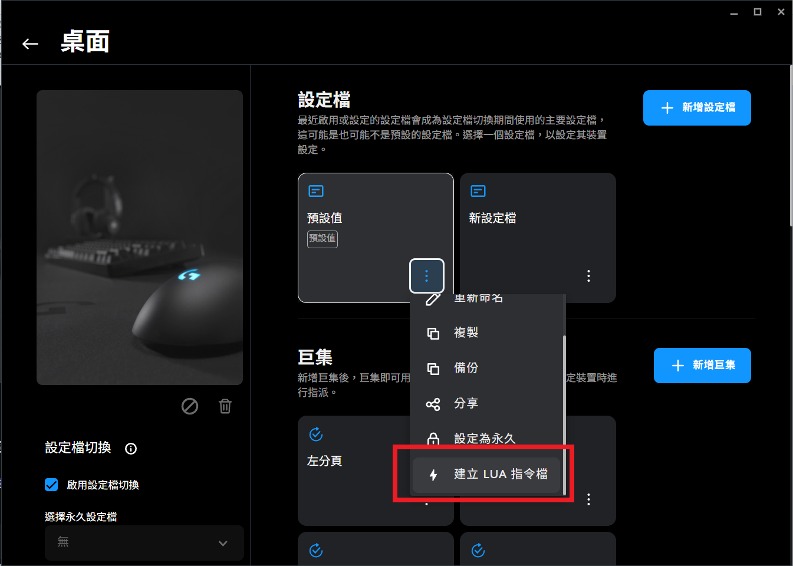
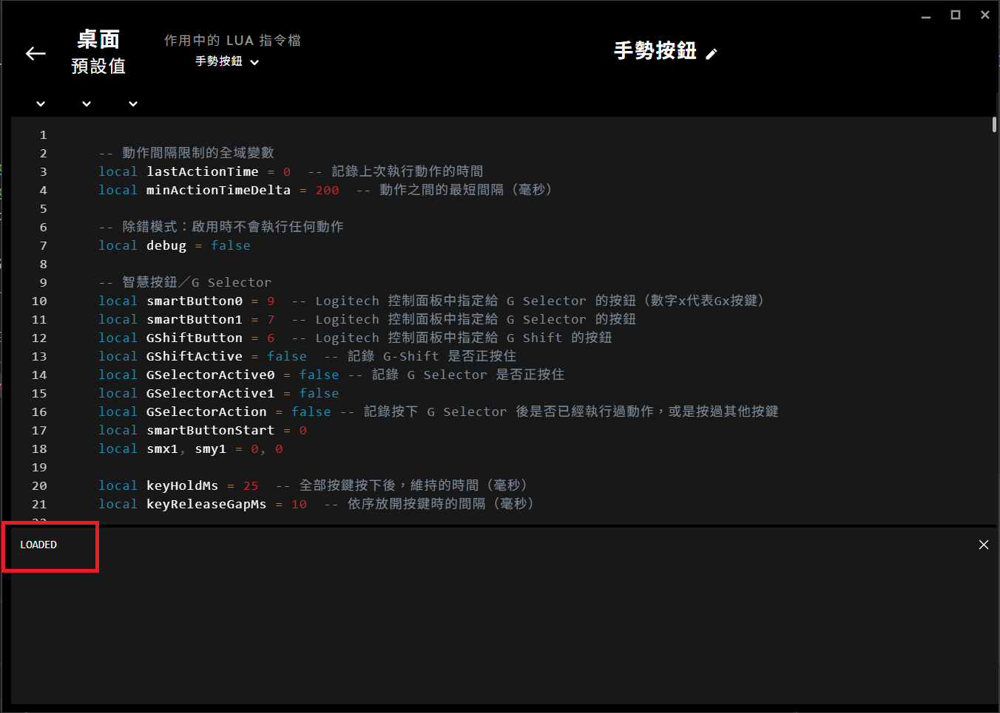

# G HUB 滑鼠手勢按鍵 (G HUB Mouse Gesture Buttons)

[English](README.en.md)


## 說明

本專案用來在 Logi G 系列裝置上，透過 [G HUB](https://www.logitechg.com/software/ghub) 的 Lua 腳本實現類似 Logi Options+ 手勢按鈕的功能。將指定的 G 按鍵作為手勢按鍵。按住按鍵並移動滑鼠，放開時依按住時間、移動距離與方向執行對應動作。

預設使用場景為 Windows 搭配 Logitech G502；手勢按鍵編號以 G HUB 中的按鍵設定為準。


受限於 G HUB Lua API，腳本無法像觸控板一樣，在手勢按鍵按住期間持續追蹤位移並流暢切換應用程式。目前是在放開手勢按鍵後，依按下與放開位置的總位移判定方向，再執行對應動作。

手勢按鍵共用一組狀態，設計上一次只處理一個手勢。
- [Windows 快捷鍵說明](https://support.microsoft.com/accessibility/windows/keyboard-shortcuts-in-windows)
- [G-series Lua API 說明](https://douile.com/logitech-toggle-keys/APIDocs.pdf)


## 使用說明
在G HUB 設定檔(在頂部選擇分頁) -> 桌面(或其他應用程式) ->  建立 Lua 設定檔 -> 建立新的LUA指令檔



複製 `手勢按鈕G502.lua` 的內容並用 `ctrl+s` 存檔


顯示 LOADED 即可使用

## 按鍵設定

需要更換按鍵時，修改 Lua 檔案開頭的變數：

| 設定 | 預設值 | 說明 |
| --- | ---: | --- |
| `GSmartButton0` | `9` | 第一顆手勢按鍵，預設 G9 |
| `GSmartButton1` | `7` | 第二顆手勢按鍵，預設 G7 |
| `GShiftButton` | `6` | G-Shift 按鍵，預設 G6 |

## 預設動作

| 手勢 | G9 | G7 |
| --- | --- | --- |
| 短按 | 播放／暫停媒體 | 開啟應用程式切換介面（Alt+Ctrl+Tab） |
| 長按 | 停止媒體 | 傳送 Enter 確認目前選項 |
| 向左 | 切換至左側虛擬桌面（Win+Ctrl+左） | Alt+Esc 切換應用程式 |
| 向右 | 切換至右側虛擬桌面（Win+Ctrl+右） | Alt+Shift+Esc 反向切換應用程式 |
| 向上 | 上一首媒體 | 開啟 Windows 工作檢視（Win+Tab） |
| 向下 | 下一首媒體 | 顯示桌面（Win+D） |

G9 的多媒體動作需要先在 G HUB 建立對應巨集。若你使用不同的巨集名稱，請修改 Lua 檔案中 `SmartButton0Action()` 對應分支的 `PlayMacro("...")` 字串，讓它和 G HUB 巨集名稱一致：

| 動作 | `SmartButton0Action()` 中的分類 | 預設巨集名稱 |
| --- | --- | --- |
| 播放／暫停 | `SHORT_CLICK` | `媒體:播放/暫停` |
| 停止 | `LONG_CLICK` | `媒體:停止` |
| 上一首 | `UP` | `媒體:上一首` |
| 下一首 | `DOWN` | `媒體:下一首` |

## 手勢判定

按住 G9 或 G7 後移動滑鼠，再放開按鍵。腳本會在放開時，根據按住時間以及按下位置到放開位置的位移，判定要執行的動作；移動期間不會即時觸發方向動作。

- **四向手勢**：目前使用四向模式，移動幅度足夠時，依主要位移軸判定上、下、左、右。
- **八向手勢**：在 `finishSmartButton0()` 和 `finishSmartButton1()` 中，將呼叫 `classifySmartButtonAction(..., false)` 的 `false` 改為 `true`。之後除上下左右外，額外分類四個對角方向。對角未設定實際動作。
- **短按／長按**：移動幅度未達手勢門檻時，按住時間短於 `smartButtonDelta`（預設 350 毫秒）判定為短按；達到或超過門檻則判定為長按。
- **移動距離限制**：位移超過 `smartButtonDistanceMax` 時取消動作；達到方向手勢的最小距離後，則按方向分類。

## 自訂動作

在 `SmartButton0Action()` 或 `SmartButton1Action()` 中修改方向對應的按鍵或巨集。例如，將 G9 向上動作改成執行另一個已建立的 G HUB 巨集：

```lua
elseif action == "UP" then
	PlayMacro("你的巨集名稱")
	return true
```

需要輸出組合鍵時，可使用 `pressKeySequence(intervalMs, ...)`。參數是按下各按鍵之間的延遲，單位為毫秒；按鍵會依序按下，再反向依序放開。

## 注意事項

- 手勢動作是在放開按鍵後才分類與執行，無法在按住期間逐段追蹤位移。
- G9、G7 共用開始時間、起始座標與動作限制狀態；目前流程刻意一次只處理一個手勢，不支援兩顆手勢按鍵同時進行。
- 對角方向的分類與動作分支尚未完成，不應假設斜向手勢會有動作。
- 按鍵名稱及快捷鍵效果可能依 G HUB、Windows 版本、系統語言與目前使用中的應用程式而異。
